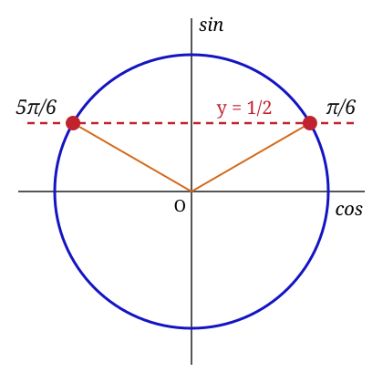

# Xưởng trang công thức (Typst)

## Cài một lần
```
pip install typst
```
(Hoặc cài Typst CLI — script tự nhận.) Muốn dùng phông riêng (vd. Be Vietnam Pro): tạo thư mục `fonts/` cạnh `build.py`, chép file .ttf vào.

## Chạy
```
python build.py vidu-dai-so.md            → vidu-dai-so.pdf (+ .typ)
python build.py vidu-luong-giac.json -o ra.pdf
python build.py thu-muc/                  → build hết .md/.json trong thư mục
python build.py file.md --typ             → chỉ sinh .typ (mở được trên typst.app)
```
Trang tràn sang trang 2 → script tự thu cỡ chữ (11 → 8pt) cho vừa 1 trang.

## Chân trang: thông tin + số trang
Ghi trong file .md (đầu file, trước khối `##` đầu tiên):
```
@tác giả: Vũ Tiến Lực
@trường: THPT Nguyễn Hữu Cảnh
@thông tin: Toán 10 – Ôn tập chương II
@ngày: auto            (auto = hôm nay)
@số trang: có          (không = tắt "Trang 1 / 2")
```
JSON: `"author"`, `"school"`, `"info"`, `"date"`, `"page_numbers": false`.

Hoặc ghi đè ngay trên dòng lệnh (không cần sửa file):
```
python build.py congthuc.md --tacgia "Vũ Tiến Lực" --truong "THPT Nguyễn Hữu Cảnh" --ngay auto
python build.py congthuc.md --nhieu-trang        (cho phép nhiều trang, không thu chữ)
python build.py congthuc.md --khong-so-trang
```
Tên tác giả và tiêu đề cũng được ghi vào thuộc tính (Properties) của file PDF.

## In PDF từ trang HTML
Mở `soan-trang-cong-thuc.html` bằng Chrome → tab **Xem trước trang** → điền thông tin chân trang → **In PDF**.
Trong hộp thoại in: chọn *Lưu dưới dạng PDF*, bật *Đồ hoạ nền*, tắt *Đầu trang và chân trang*.

## Trình chiếu 16:9 (trên trang HTML)
Dán .md/JSON → bấm **▶ Trình chiếu**. Mỗi khối công thức thành một slide chữ to, đậm (khối dài tự chia 1/2, 2/2),
mỗi chủ đề có slide bìa. Chữ tự phóng to cho kín slide.
- 6 kiểu màu: Sáng – màu khối, Rực rỡ, Giấy kem, Bảng đen phấn, Đêm xanh, Tương phản cao (máy chiếu phòng sáng).
- Độ đậm công thức: thường / đậm / rất đậm; A− A+ chỉnh cỡ chữ; **Hiện từng dòng** để giảng lần lượt.
- Mặc định slide **lấp đầy mọi màn hình** (16:9, 16:10, 3:2, 4:3…); nút ▣ Lấp đầy / ▭ 16:9 hoặc phím **L** để đổi sang giữ khung 16:9 có viền đen.
- Phím: → / Space / Enter: tiếp · ←: lùi · F: toàn màn hình · T: đổi màu · B: đổi độ đậm · + / −: cỡ chữ · H: thu gọn/hiện menu · Esc: thoát.
- Bấm nửa phải slide để tiến, nửa trái để lùi; trên điện thoại/iPad vuốt ngang.

## Ứng dụng dạy học Toán – Thầy Vũ Tiến Lực (ung-dung-day-hoc-toan.html) — trước đây là "ứng dụng dạy học Toán Công Thức"
Bản web app để đưa lên Vercel nằm trong thư mục `web-app/` (xem `web-app/README.md`): cài được như ứng dụng, chạy khi mất mạng.
Thanh bên trái: **Soạn & chiếu · Tạo bài bằng AI · In phiếu · Trang web · Hướng dẫn**.

### Trang web dạy học trong cửa sổ
Mục **Trang web** (hoặc nút 🌐 trên thanh trên / menu trình chiếu / cột công cụ góc, phím **N** khi đang chiếu):
Trình chiếu ảnh dạy học · Lớp học Tích Cực · Máy tính CalcES (Casio online) · Sân khấu Chúc mừng — và trang thầy tự thêm.
Mở dạng **¼ màn hình**, **½ màn hình** hoặc **toàn màn hình**; kéo thanh tiêu đề để di chuyển, ⇆ đổi bên, ⟳ tải lại.
**— Ẩn** chỉ giấu cửa sổ: trang vẫn chạy ngầm, giữ nguyên dữ liệu đang làm (điểm, ảnh, phép tính…). Mở lại là thấy như cũ.
Trang nào không cho hiển thị trong khung thì bấm **↗ Tab mới**.

### Trình chiếu bài dạy
Mở file bằng Chrome, dán bài .md (mẫu: `bai-giang-pt-luong-giac-co-ban.md`) → **▶ Trình chiếu**.
Cùng cú pháp .md, thêm 2 loại khối:
```
## Ví dụ 1 {vidu}
Đề bài ...
>> Bước giải 1          (hiện lần lượt mỗi lần bấm →)
=> Kết luận             (đóng khung, hiện cuối)

## Thực hành 1 {thuchanh, 2 phút}
Đề ...
A. ...
*B. ...                 (* = đáp án đúng)
a) Mệnh đề ... {Đ}      (câu đúng/sai)
=> 15                   (câu trả lời ngắn)
>> Lời giải ngắn
```
Khi chiếu: bấm phương án/mệnh đề để chấm câu học sinh trả lời; → hiện đáp án rồi lời giải; G đồng hồ (hết giờ có chuông);
R bốc thăm học sinh theo sĩ số; P bút vẽ lên slide; O tổng quan; . màn đen; H thu gọn menu; ? bảng phím tắt.
build.py tự bỏ qua khối {vidu}/{thuchanh} khi in PDF, nên một file dùng được cả để in lẫn để giảng.

### Tạo bài bằng AI
Mục **Tạo bài bằng AI**: chọn **loại bài**, tên bài, lớp, bộ sách, **đối tượng lớp** (đại trà / khá – giỏi / cần hỗ trợ / phân hoá),
**năng lực trọng tâm** (5 thành phần năng lực toán học GDPT 2018), số ví dụ, số câu → **① Sao chép prompt** → dán vào AI →
**② Dán kết quả AI** (tự bỏ dấu ```markdown, tự chọn kiểu chiếu phù hợp).
9 loại bài: Bài giảng mới (4 hoạt động) · Khởi động 5 phút · Khám phá kiến thức · Tiết luyện tập · Phân hoá 3 mức ·
Sửa sai lầm thường gặp · Toán thực tế – mô hình hoá · Trò chơi thi đua · Ôn tập chương / ôn kiểm tra.

### Công cụ ở góc khi ẩn menu
Bấm H (hoặc ▾ Ẩn) để giấu thanh menu; góc phải dưới còn nút ✎ mờ. Bấm vào để mở cột công cụ nhỏ:
lùi/tiếp, bút vẽ (chọn màu, xoá nét), hiện đáp án, đồng hồ, gọi học sinh, tự động, tổng quan, màn đen, ☰ hiện lại menu đầy đủ.

### Luyện tập củng cố một chủ đề
Khung **Chọn bài để chiếu** (bên phải): chọn **Chủ đề** (với file nhiều chủ đề như `on-tap-giua-ki-1-toan-11.md`) và **Kiểu bài**:
- *Bài giảng đầy đủ*: công thức → ví dụ → thực hành theo đúng thứ tự trong file.
- *Luyện tập củng cố*: bìa → nhắc lại công thức → (ví dụ mẫu nếu tích) → Câu 1/N … Câu N/N → Ghi nhớ → **Tổng kết**.
- *Chỉ câu luyện tập*: bìa → các câu → Tổng kết.
Tích **Đảo thứ tự câu** để mỗi lần chiếu ra thứ tự mới. Slide Tổng kết đếm số câu trắc nghiệm lớp chọn đúng ngay lần đầu
(thầy bấm vào phương án học sinh chọn khi chiếu).

### Đầu slide gọn (mặc định)
- Thanh tiêu đề mỗi slide được thu hẹp lại, chỉ ghi tên ví dụ, tên câu thực hành hoặc tên khối công thức. Câu thực hành vẫn giữ đồng hồ ở góc phải.
- Những phần phụ được bỏ đi: tên bài, nhãn “VÍ DỤ / THỰC HÀNH”, dòng nhắc “Bấm vào phương án…” và nhãn loại slide ở chân trang. Chân trang chỉ còn số trang nhỏ, mờ.
- Phần nội dung nhờ đó có thêm chỗ, chữ tự to hơn.
- Muốn xem lại tiêu đề đầy đủ: bấm nút **▔ Đầu gọn** trên menu chiếu hoặc phím **J**. Lựa chọn được ghi nhớ cho các lần chiếu sau.

### Chiếu tự động
Bấm **⏵ Chiếu tự động** (hoặc phím **A** khi đang chiếu). Slide tự chuyển; ví dụ hiện từng bước; câu luyện tập chạy đồng hồ
suy nghĩ → hết giờ có chuông, tự hiện đáp án → lời giải → câu tiếp. Thanh mảnh trên đỉnh slide cho biết còn bao lâu.
Tự dừng tạm khi thầy bật bút vẽ, gọi học sinh, mở tổng quan hoặc che màn; bấm ← → vẫn điều khiển tay được.
Cài đặt: tốc độ (chậm/vừa/nhanh), thời gian suy nghĩ (theo từng câu hoặc cố định 15 giây – 1 phút 30), lặp lại khi hết bài.

## In phiếu làm bài có dòng kẻ cho học sinh
Lấy các khối `{thuchanh}` (và `{vidu}` làm bài tự luận) của từng chủ đề, xếp theo đề THPT:
Phần I trắc nghiệm · Phần II đúng/sai (bảng ô Đúng/Sai) · Phần III trả lời ngắn (ô Đáp số) · Phần IV tự luận.
Mỗi câu có **2 dòng kẻ** để làm bài (tự luận gấp 3), đầu phiếu có Họ tên – Lớp – Điểm, trang cuối là đáp án + gợi ý.
```
python build.py on-tap-giua-ki-1-toan-11.md --phieu                  → ...-phieu.pdf (mọi chủ đề, mỗi chủ đề 1 phiếu)
python build.py on-tap-giua-ki-1-toan-11.md --phieu --chu-de 3       → chỉ chủ đề 3
python build.py bai.md --phieu --dong 3 --kieu-dong lien             → 3 dòng liền mỗi câu
python build.py bai.md --phieu --kem-cong-thuc --khong-dap-an        → có khung nhắc lại công thức, bỏ trang đáp án
python build.py bai.md --phieu --khong-vi-du --dong-tu-luan 8
```
**Phiếu siêu tiết kiệm** (ít giấy nhất): thêm `--tiet-kiem`
```
python build.py on-tap-giua-ki-1-toan-11.md --phieu --tiet-kiem     → ...-phieu-tiet-kiem.pdf
```
2 cột, chữ 9,5pt, lề 0,8 cm, đen trắng (không màu), dòng kẻ 6 mm, tiêu đề phiếu gọn 1 dòng, các chủ đề in nối tiếp
không sang trang mới, tự luận 4 dòng; đáp án gọn trên **trang riêng cuối** (không cần photo cho học sinh).
Ôn tập Toán 11 (5 chủ đề): 11 trang học sinh → **3 trang** (+1 trang đáp án).
Trên ứng dụng: mục **In phiếu** → chọn chủ đề (số dòng, kiểu dòng, tên trường, tự luận, công thức, đáp án, **Siêu tiết kiệm**) → **🖨 In phiếu làm bài**.

## Hình minh hoạ gắn theo từng ý (khi trình chiếu)

Đặt ảnh **ở cuối đúng dòng** cần minh hoạ. Ảnh thuộc về dòng đó, nên chỉ hiện khi dòng đó được mở.

```
Giải phương trình $\sin x = \frac{1}{2}$.
[ảnh: https://…/de-bai.png | Đồ thị y = sin x]      ← ảnh của đề: hiện ngay từ đầu
>> Ta có …
>> Đường thẳng $y=\frac12$ cắt đường tròn …     ← chỉ hiện khi tới bước 2
=> $x = \frac{\pi}{6}+k2\pi$ …
*A.                        ← ảnh trong phương án: hiện ngay trong ô
[ảnh: Trục tang với điểm có tung độ √3]               ← chưa có link: khung chờ “Chèn ảnh: …”
```

Có hai kiểu viết: `` hoặc `[ảnh: link | chú thích]`. Thay chữ `ảnh` bằng `hình` cũng được.

**Chèn ảnh bằng menu (không cần nhớ cú pháp)**: ở trang Soạn, đặt con trỏ vào đúng dòng cần ảnh rồi bấm **🖼 Chèn ảnh vào dòng đang chọn** (hoặc **Alt+I**). Khung chèn ảnh đi theo con trỏ:
- Khung cho biết đang ở dòng nào, thuộc khối nào, và **ảnh sẽ hiện khi nào**. Ví dụ: “Ảnh của BƯỚC 2 — chỉ hiện khi mở tới bước 2”, “Ảnh nằm ngay trong ô PHƯƠNG ÁN B”, “Ảnh của ĐỀ — hiện ngay khi mở câu”.
- Lấy ảnh theo một trong ba cách: dán link (https, Google Drive, `hinh/abc.png`), bấm **📷 Ảnh từ máy…**, hoặc dán ảnh trực tiếp (Ctrl+V, kéo thả).
  - Ảnh từ máy được thu về tối đa 1400 px rồi nhúng **ở cuối bài** dạng `[@h1]: data:…`. Dòng soạn chỉ còn `` cho gọn.
- Chọn vị trí đặt ảnh:
  - **Cuối dòng này**: ảnh của đúng ý, bước hay phương án đó. Với mệnh đề đúng sai, ảnh được đặt trước `{Đ}/{S}`.
  - **Dòng riêng ngay dưới**: ảnh cho cả câu hoặc cả mục. Nếu dòng đang chọn là công thức `$$` nhiều dòng thì ảnh đặt sau dòng `$$` đóng.
- Dòng đã có ảnh: khung tự điền sẵn để **thay ảnh**, và có nút **Xoá ảnh khỏi dòng**. Dữ liệu ảnh nhúng không còn dùng sẽ tự được dọn.
- Chưa có ảnh: bấm **Chèn chỗ chờ ảnh**, ứng dụng ghi `[ảnh: mô tả]` để bổ sung sau.
- Thanh nhỏ trên ô soạn luôn cho biết vị trí con trỏ, ví dụ “Dòng 39 · Ví dụ 3 · bước 1 · 🖼 có ảnh”.
- Lưu ý: ảnh nhúng lớn làm bài nặng. Một ô Google Sheets chứa tối đa 50.000 ký tự, nên bài có nhiều ảnh nhúng muốn đồng bộ Sheets thì nên dùng link ảnh.

Link có thể là:
- link https,
- đường dẫn tương đối (thư mục `hinh/` cạnh index.html khi đưa lên Vercel),
- `data:image/...`,
- link Google Drive. Ảnh phải để chế độ "ai có link cũng xem được"; ứng dụng tự đổi link sang dạng hiển thị được.

**Bố cục khi chiếu: “ảnh đi theo ý đang giảng”**
- Slide có ảnh chia đôi: nội dung bên trái, khung ảnh bên phải.
  - Khung ảnh tự đổi bề rộng: ảnh ngang thì rộng khoảng 52%, ảnh dọc thì hẹp khoảng 34%.
  - Trên màn hình đứng, khung ảnh xuống dưới.
- Khung ảnh luôn hiện ảnh của dòng hoặc bước **mới nhất đã mở**. Dòng nguồn có biểu tượng 🖼, và biểu tượng này sáng lên khi ảnh của dòng đó đang hiện.
- Chưa tới dòng có ảnh thì khung ảnh thu lại, nội dung chiếm hết bề rộng và chữ tự phóng to.
- Bỏ chế độ “Từng dòng” thì slide công thức hiện tất cả ảnh dạng lưới, tối đa 4 ảnh.
- **Ẩn ảnh**:
  - Mỗi ảnh có nút ✕ mờ ở góc. Bấm nút này để ẩn ảnh **chỉ ở slide đang chiếu**; nội dung sẽ giãn ra hết bề rộng.
  - Mép phải màn hình còn một tab mờ “🖼 Hiện ảnh”; bấm vào tab đó để ảnh hiện lại.
  - Phím **I** hoặc nút “🖼 Ảnh” ẩn hoặc hiện ảnh ở mọi slide.
- **Phóng to toàn màn hình**: bấm vào ảnh, bấm nút ⛶ ở góc ảnh, hoặc nhấn phím **V**. Ảnh mở trên nền tối, che hết các thanh công cụ.
  - Cuộn chuột hoặc dùng hai ngón tay (trên màn hình cảm ứng) để phóng tới 800%. Có nút − và +.
  - Kéo ảnh để xem chi tiết. Nhấp đúp để phóng nhanh 250%, nhấp đúp lần nữa để trở về vừa màn hình. Phím 0 hoặc nút % cũng đưa ảnh về vừa màn hình.
  - Slide có nhiều ảnh: dùng ← →, vuốt ngang hoặc nút ◀ ▶ để chuyển ảnh.
  - Nút ⛶ hoặc phím F bật toàn màn hình thật. Esc, phím V, nút ✕ hoặc chạm ra nền tối để đóng.
  - Khi đang xem ảnh, chế độ tự động chạy tạm dừng.
- Ảnh của 2 slide kế tiếp được tải trước. Link hỏng sẽ báo “Không tải được ảnh”.
- Nút **Kiểm tra** đếm số ảnh và liệt kê các chỗ còn chờ chèn ảnh.
- Phiếu in: ảnh của đề được in kèm, cao tối đa khoảng 45 mm, và khung chờ được bỏ qua. Trang công thức PDF (build.py) bỏ qua ảnh.

Lưu ý: khi xem trong Claude, trang chặn ảnh từ web ngoài; ảnh `data:` vẫn hiện. Mở file trên máy hoặc bản Vercel thì mọi link đều chạy.

## Thư viện MD (quản lý các bài .md)

Menu **📚 Thư viện MD** ở thanh bên dùng để quản lý các bài .md.

**Tải bài lên**
- Bấm **⤒ Tải lên file .md…** để chọn nhiều file cùng lúc. Có thể chọn file .md, .txt và .json, kể cả file sao lưu của SmartLesson MD Pro.
- Bấm **📁 Tải cả thư mục…** để nạp hết các file trong một thư mục.
- Cũng có thể kéo thả file vào trang.
- Ở trang Soạn, nút “Mở file…” chọn 1 file thì mở luôn vào ô soạn. Chọn nhiều file thì tất cả được đưa vào thư viện.

**Ứng dụng tự nhận thông tin của mỗi bài** theo thứ tự sau:
1. Phần đầu file kiểu YAML:
   ```
   ---
   Lớp: Lớp 11
   Mã bài: Bài 1
   Tên bài: Phương trình lượng giác cơ bản
   Chú thích: dạy 11A3
   Chọn nhanh: Bài giảng mới
   Từ khóa: sin, cos, nghiệm
   ---
   ```
2. Tên file dạng “Lớp 10 - Tên bài - Chú thích.md”.
3. Dòng `@tên bộ:` hoặc dòng `#` đầu tiên trong bài.

Lớp được đoán từ chữ “Toán 10”, “Lớp 11”. Loại bài được đoán theo 9 loại của “Tạo bài bằng AI”.
Bài trùng tên và trùng lớp thì không tạo bản thứ hai: nội dung giống hệt thì bỏ qua, nội dung khác thì cập nhật bài cũ.

**Tìm và lọc bài**
- Ô tìm kiếm (phím `/`) tìm trong tên bài, từ khoá và cả nội dung.
- Có thể lọc theo lớp và theo loại bài, hoặc bấm các chip loại bài.
- Sắp xếp theo bài mới cập nhật, theo tên, hoặc theo lớp và mã bài.

**Với mỗi bài**
- **▶ Chiếu** và **⏵ Tự động** chiếu ngay. Nhấp đúp vào bài trong danh sách cũng chiếu ngay.
- **✎ Mở để soạn**: đưa bài sang trang Soạn. Sửa xong, bấm **📚 Lưu vào thư viện** để cập nhật đúng bài đó. Nếu tiêu đề trong nội dung đã đổi sang bài khác thì ứng dụng lưu thành bài mới.
- **Sửa thông tin**: sửa lớp, mã bài, tên, chú thích, loại bài, từ khoá.
- **⤓ Tải .md**: tải file có kèm phần đầu YAML, nên khi nạp lại vẫn giữ đủ thông tin.
- **Nhân bản** và **Xoá**.

**Chiếu nhiều bài liền mạch**
- Tải nhiều file .md cùng lúc, bằng nút Tải lên ở Thư viện hoặc “Mở file…” ở trang Soạn. Ứng dụng tự **chọn sẵn các bài vừa tải** theo thứ tự file và hiện khung **Chiếu nhiều bài**.
- Cũng có thể tự tick ô vuông bên trái từng bài. Số in dưới ô vuông là thứ tự chiếu. Nút **☑ Chọn tất cả để chiếu** chọn mọi bài đang lọc, ví dụ tất cả bài Lớp 10 loại “Tiết luyện tập”.
- Trong khung Chiếu nhiều bài:
  - Dùng ↑ ↓ để đổi thứ tự, ✕ để bỏ một bài.
  - Chọn cách chiếu: **mỗi bài theo loại bài của nó** (bài giảng chiếu đầy đủ, bài luyện tập chiếu dạng luyện tập), hoặc **tất cả theo Kiểu bài** đang chọn ở trang Soạn.
- **▶ Chiếu N bài liền mạch** và **⏵ Chiếu tự động**:
  - Slide đầu là mục lục buổi học.
  - Mỗi bài mở bằng một slide bìa ghi “Bài k/N”, chân slide luôn ghi “Bài k/N”.
  - Phím **]** sang bài sau, phím **[** về bài trước. Phím O mở tổng quan, có đánh dấu ▸ chỗ bắt đầu mỗi bài.
  - Thoát chiếu thì trang Soạn trở về bài đang soạn như cũ.
- **✎ Gộp thành một bộ**: ghép các bài thành một file .md trong ô soạn, mỗi bài là một chủ đề `#`. Sau đó có thể sửa, in phiếu cả bộ, hoặc chọn từng chủ đề để chiếu.
  - Ảnh nhúng được đổi mã để không trùng nhau.
  - Bài đang soạn chưa lưu sẽ được tự lưu vào thư viện trước khi gộp.

**Lưu bài: chọn lớp và loại bài (cấu trúc prompt)**
- Bấm **📚 Lưu vào thư viện** ở trang Soạn để mở khung lưu. Khung có các ô: Tên bài, **Lớp**, **Loại bài (cấu trúc prompt)**, Mã bài, Chú thích.
  - Bài vừa dán từ “Tạo bài bằng AI” thì ô Lớp và Loại bài tự điền đúng lựa chọn đã dùng khi sinh prompt, ví dụ Lớp 10 · Phiếu phân hoá 45'.
  - Bài khác thì ứng dụng tự đoán từ nội dung.
- **Xếp bài theo**:
  - **Lớp → loại bài**: `Lớp 10 / Phiếu phân hoá 45' / Tên bài.md`
  - **Cấu trúc prompt → lớp**: `Phiếu phân hoá 45' / Lớp 10 / Tên bài.md`
  - Dòng 📁 ngay dưới cho xem trước đường dẫn sẽ lưu.
- Bài đang mở từ thư viện: nút **Cập nhật bài** ghi đè đúng bài đó, nút **Lưu thành bài mới** tạo một bản riêng.
- Trong Thư viện MD, ô **Xếp theo** nhóm danh sách có tiêu đề theo cách đã chọn, hoặc chọn “Không nhóm”.
- Nút **⤓ Tải thư mục .zip** tải các bài đang lọc thành thư mục đúng cấu trúc trên. Mỗi file .md có phần đầu ghi Lớp, Mã bài, Chọn nhanh…, nên khi tải lên lại ứng dụng vẫn nhận đủ thông tin.

**Lưu và sao lưu**
- Thư viện lưu trong trình duyệt của máy đang dùng.
- Bấm **⤓ Sao lưu .json** định kỳ để giữ bản an toàn.

**Google Sheets (tuỳ chọn)**
- Mở mục ⚙ và làm theo 4 bước để tạo Apps Script, có nút sao chép mã.
- Mã này giống hệt mã của SmartLesson MD Pro. Vì vậy hai ứng dụng có thể dùng **chung một bảng**.
- Khi tải từ Sheet về, ứng dụng **gộp** theo id, bản nào mới hơn thì giữ. Bài chỉ có trên máy không bị xoá.
- Mỗi lần thêm, sửa, xoá bài, ứng dụng tự đẩy bài đó lên Sheet.
- Lưu ý: khi xem trong Claude, trang chặn kết nối ra ngoài. Muốn đồng bộ, mở file trên máy hoặc bản Vercel.

**SmartLesson MD Pro (file của thầy) đã được sửa**, nằm trong `smartlesson/smartlesson-md-pro.html`. Các lỗi đã sửa:
- **Lỗi chính:** hàm `insertLessonTemplate` bị cụt nửa chừng làm hỏng cú pháp, nên **toàn bộ mã JavaScript không chạy**. Vì vậy không tải lên được file .md và mọi nút khác cũng không hoạt động.
- Ba hàm đồng bộ bị khai báo hai lần. Bản sau ghi đè bản có chế độ chạy ngầm, khiến lần đồng bộ 10 giây thay toàn bộ dữ liệu bằng dữ liệu trên Sheet và làm **mất bài vừa tải lên**. Nay ứng dụng gộp theo id và chờ 15 giây sau mỗi lần ghi lên Sheet.
- Dữ liệu và đường dẫn Sheet được lưu trên máy, nên tải lại trang không còn mất.
- Đọc được file có BOM hoặc xuống dòng kiểu Windows.
- Không còn cắt nhầm tên file có dấu gạch nối.
- Bỏ qua file trùng.
- Tải nhiều file thì đẩy từng bài lên Sheet (UPSERT) thay vì xoá trắng bảng rồi ghi lại.
- Nhận được dòng `@tên bộ`, và đoán lớp từ “Toán 10”.

## Ảnh mở đầu bài

Ở trang Soạn, ô **🌅 Ảnh mở đầu bài** nằm ngay trên ô nội dung. Thầy dán link ảnh (https, Google Drive, `hinh/bia.jpg`), bấm **📷 Từ máy…**, hoặc Ctrl+V ảnh vào ô. Sau đó bấm **Gắn ảnh**; có thể thêm chú thích nếu muốn.

Ứng dụng ghi vào đầu bài dòng:
```
@ảnh mở đầu: https://…/anh.jpg | chú thích
```
- Bấm Trình chiếu thì **slide đầu tiên là ảnh này**, chiếm toàn màn hình. Nền là chính ảnh đó làm mờ, tên bài và chú thích hiện ở phía dưới. Bấm vào ảnh để phóng to.
- Khi chiếu nhiều bài, bài nào có ảnh mở đầu thì ảnh đó mở đầu đúng bài ấy.
- Ảnh từ máy được nhúng ở cuối bài, giống cách chèn ảnh vào dòng.
- Nút **Bỏ ảnh** xoá dòng `@ảnh mở đầu`.

## Chiếu kiểu video & quay thành video

**🎬 Chiếu kiểu video**

Nút này có ở trang Soạn, trong khung Chiếu nhiều bài, trên thanh menu khi đang chiếu, và bằng phím **M** để chiếu từ slide đang mở.
- Mọi loại slide chạy giống nhau:
  1. **Từng dòng hiện ra chậm**, có vạch màu đánh dấu dòng đang đọc. Thời gian dừng ở mỗi dòng tính theo độ dài chữ và số công thức.
  2. Hết dòng thì slide giữ thêm một lúc.
  3. Sau đó **tự chuyển sang slide sau** với hiệu ứng mờ dần, trượt ngang hoặc phóng nhẹ.
- Trên từng loại slide:
  - Bìa: hiện lần lượt tiêu đề rồi các mục.
  - Công thức: hiện từng dòng.
  - Ví dụ: hiện đề, rồi từng bước giải, rồi kết luận.
  - Câu luyện tập: hiện đề, rồi từng phương án hoặc mệnh đề. Tiếp theo là **đếm ngược suy nghĩ**, sau đó hiện đáp án (tô xanh phương án đúng) và lời giải.
  - Ảnh minh hoạ hiện theo đúng dòng đang đọc. Ảnh mở đầu phóng chậm.
- Trong lúc chiếu, menu và con trỏ chuột được ẩn để màn hình sạch.
- Phím tắt:
  - Space hoặc bấm chuột: tạm dừng / chạy tiếp.
  - ← →: lùi hoặc bỏ qua slide.
  - Esc hoặc M: dừng.
- **Tăng tốc**:
  - Trước khi chiếu: chọn **Tăng tốc cả video** từ ×0,75 đến ×4 trong cài đặt. Mức tăng tốc áp dụng cho mọi khoảng dừng, hiệu ứng hiện dòng và chuyển slide.
  - Ngay trong lúc chiếu hoặc quay:
    - **↑** hoặc **+** tăng tốc, **↓** hoặc **−** giảm tốc (×0,5 → ×4).
    - Phím **1 2 3 4** chọn nhanh ×1…×4, phím **0** về ×1.
  - Khi chiếu (không quay), nhãn tốc độ hiện thoáng ở giữa đáy màn hình. Khi quay, nhãn này không hiện để khỏi lọt vào video; tốc độ hiện trên tên tab trình duyệt (“▶ ×2 — …”).
  - Đếm ngược “Suy nghĩ…” vẫn chạy đúng từng giây thật, không bị tăng tốc.
- Chỉnh ở mục **Chiếu kiểu video / quay video** trong cài đặt: tốc độ hiện dòng (rất chậm → nhanh), thời gian dừng suy nghĩ trước đáp án, hiệu ứng chuyển slide.

**⏺ Quay thành video**

Nút này chạy chế độ video như trên và ghi lại thành file.
- Trình duyệt hỏi chia sẻ màn hình: chọn **Tab này** rồi bấm **Chia sẻ**. Màn hình chuyển toàn màn hình, chấm đỏ nhấp nháy rồi tắt, và bắt đầu quay.
- Hết bài thì ứng dụng tự lưu file **.mp4** trên Chrome/Edge mới. Trình duyệt cũ hơn lưu file **.webm**, mở bằng Chrome/VLC hoặc đổi sang MP4 bằng CapCut.
- **Kèm âm thanh và hình của thầy**: chọn trong mục cài đặt “Chiếu kiểu video / quay video”.
  - **Âm thanh hệ thống của máy: luôn bật sẵn.** Mặc định ứng dụng quay **toàn màn hình kèm âm thanh cả máy**, gồm tiếng trong tab, video YouTube, phần mềm khác, nhạc nền. Trang chiếu tự chuyển sang toàn màn hình nên video chỉ có slide.
    - Khi trình duyệt hỏi: chọn **Toàn bộ màn hình**, tick **“Chia sẻ âm thanh hệ thống”** rồi bấm Chia sẻ.
    - Nếu trình duyệt không tự bật toàn màn hình, màn hình hiện nút **“⏺ Bấm để bắt đầu quay”**: bấm một lần là bắt đầu.
    - Thanh “Đang chia sẻ màn hình” của Chrome nổi ở đáy màn hình: bấm **Ẩn** để nó không lọt vào video.
    - Âm thanh của cả máy thu được trên Windows và ChromeOS. Máy Mac chỉ thu được tiếng của tab: chọn **Nguồn quay → Chỉ tab này** rồi tick “Chia sẻ cả âm thanh của thẻ”.
  - **Micro**: ghi giọng thầy giảng. Giọng được lọc ồn, lọc vọng, rồi trộn chung với âm thanh hệ thống thành một kênh.
  - **Camera**: khung tròn hình thầy ở góc màn hình. Chọn được góc và cỡ (nhỏ, vừa, lớn). Hình hiện như soi gương. Camera cũng bật khi chỉ “Chiếu kiểu video”, tiện cho thầy quay bằng phần mềm khác.
  - Lần đầu dùng, trình duyệt sẽ hỏi quyền micro và camera, thầy bấm **Cho phép**.
  - Quên tick âm thanh của thẻ thì video không có tiếng hệ thống, ứng dụng sẽ nhắc khi lưu file.
- Bấm Esc giữa chừng: dừng và lưu phần đã quay.
- Tạm dừng thì máy quay cũng dừng, nên video không có đoạn đứng yên.
- Lúc quay, mọi thông báo đều bị ẩn để không lọt vào video.
- Lưu ý: trang xem trong Claude không cho quay màn hình. Thầy mở file trên máy hoặc bản Vercel để quay, hoặc dùng “🎬 Chiếu kiểu video” kèm phần mềm quay màn hình (ví dụ tiện ích Quay Màn Hình Pro của thầy).

## Tạo bài bằng AI từ PDF / ảnh thầy cung cấp

Vào mục **Tạo bài bằng AI** → ô **Nguồn kiến thức** → chọn **“Từ PDF / ảnh thầy đính kèm”**.
- Có thể ghi **phạm vi**, ví dụ “trang 20–24, bài tập 1.5–1.9”. Ô “Bài học” để trống được, AI lấy tên bài theo tài liệu.
- Bấm **① Sao chép prompt**. Mở Claude, ChatGPT hoặc Gemini, **đính kèm file PDF hoặc ảnh** rồi dán prompt vào cùng tin nhắn và gửi. Chép kết quả AI trả về, sau đó bấm **② Dán kết quả AI**.
- Prompt yêu cầu AI làm những việc sau:
  - Đọc hết tài liệu; chỉ lấy kiến thức, công thức, ký hiệu và tên dạng toán **từ tài liệu**, không thêm kiến thức ngoài hay vượt chương trình.
  - Ưu tiên dùng lại hoặc đổi số liệu từ ví dụ và bài tập có sẵn trong tài liệu.
  - Ghi nguồn bằng dòng `<!-- nguồn: trang … -->`. Dòng này ẩn khi chiếu và khi in.
  - Hình trong tài liệu được ghi thành `[ảnh: mô tả – trang …]` để thầy cắt ảnh rồi chèn vào.
  - Chỗ nào tài liệu mờ thì ghi `<!-- cần kiểm tra: … -->`, không tự bịa.
  - Tự giải lại từng câu để kiểm tra đáp số trước khi trả lời.

**Hai loại bài mới theo phiếu mẫu của thầy**
- **Phiếu phân hoá 45'** gồm 5 phần:
  1. Kiến thức cần nhớ, nhận diện dạng và câu hỏi kích hoạt.
  2. Hai dạng toán, mỗi dạng có D·.M (ví dụ mẫu giải từng bước, có lỗi thường gặp) và D·.T (bài tương tự kèm gợi ý 3 nấc).
  3. Sáu câu luyện tập A1–A3, B1–B2, C1 cùng lộ trình gợi ý.
  4. Phát hiện sai lầm.
  5. Phiếu thoát và tự đánh giá.
- **Phiếu phân hoá 90'** gồm 6 phần:
  1. Khởi động 3 câu, kiến thức cần nhớ và bảng nhận diện dạng.
  2. Ba dạng toán, mỗi dạng có ví dụ mẫu và bài tương tự.
  3. Mười hai câu luyện tập A1–A5, B1–B4, C1–C3.
  4. Hai bài phân tích sai lầm.
  5. Vận dụng thực tế, có câu mở rộng.
  6. Kiểm tra cuối buổi 3 câu, tự đánh giá, và ghi chú cho giáo viên (phân bổ thời gian, tiêu chí đánh giá).
- Hai loại này có cấu trúc cố định nên ô số câu bị khoá, và ô đối tượng tự chọn “nhiều trình độ”.
- Không cần 3 tài liệu riêng như prompt gốc, vì ứng dụng tự tách:
  - **Phiếu học sinh**: mục In phiếu, hoặc `build.py --phieu`.
  - **Bảng đáp số**: lấy từ các dòng `=>`.
  - **Hướng dẫn giải**: lấy từ các dòng `>>`, in thành trang đáp án riêng ở cuối.
  - Mã câu (A1, B2, C1, D1.T…) giữ nguyên trên phiếu và trong bảng đáp án.
- Bài mẫu: `mau-phieu-phan-hoa-45-phut.md`, kèm sẵn bản PDF phiếu học sinh có trang đáp án.

## Hình SVG (vẽ bằng AI hoặc dán mã) — chiếu và in giống nhau

**Thay một hình**
1. Đặt con trỏ vào dòng cần hình, bấm **🖼 Chèn ảnh vào dòng đang chọn**.
2. Chọn một trong hai cách:
   - **Dán mã SVG** (`<svg …>…</svg>`) vào ô “Hoặc dán mã SVG”. Mã có thể lấy từ AI, GeoGebra hoặc TikZ → SVG Studio.
   - Chọn **file .svg** từ máy.
3. Chưa có hình thì bấm **🤖 Nhờ AI vẽ SVG**. Ứng dụng sao chép lệnh vẽ, kèm mô tả và nội dung khối bài để AI hiểu ngữ cảnh. Dán lệnh vào AI, rồi dán mã SVG AI trả về vào ô.
4. Bấm **Chèn vào dòng**. Hình SVG được nhúng ở cuối bài và giữ nét khi phóng to toàn màn hình.

**Thay mọi chỗ chờ ảnh cùng lúc**
- Bấm **✏️ Vẽ SVG cho chỗ chờ ảnh**. Ứng dụng đánh số các chỗ chờ `[ảnh: …]` thành H1, H2…
- **① Sao chép lệnh vẽ hình**: một lệnh nhờ AI vẽ tất cả hình. Lệnh có quy tắc: nền trắng, nét đậm khi chiếu, nhãn Unicode, toạ độ chính xác, hình của đề không ghi đáp số.
- Dán toàn bộ câu trả lời của AI vào ô, bấm **② Thay vào bài**. Mỗi chỗ chờ được thay bằng đúng hình của nó, kèm ảnh xem nhanh. Hình còn thiếu thì vẫn giữ chỗ chờ.
- Ứng dụng tự làm sạch mã SVG (bỏ script, sự kiện, liên kết ngoài) trước khi nhúng.

**In ra PDF giống khi chiếu**
- `build.py` giờ in luôn hình vào trang công thức và phiếu làm bài, ngay dưới đúng dòng chứa hình. Các loại hình được in:
  - ảnh nhúng (`[@id]: data:…`, gồm SVG, PNG, JPG; WebP tự đổi sang PNG);
  - file trên máy, đường dẫn tính theo thư mục chứa file .md (ví dụ `hinh/abc.svg`).
- Link web và chỗ chờ `[ảnh: mô tả]` không được in.
- Hình nằm sau lời giải (`>>`) không in vào đề, để không lộ đáp án.
- Hình được tách ra thư mục `hinh-nhung/` cạnh file .typ để Typst đọc.

## Phiếu hoạt động nhóm (in A4 ngang, 2 trang)

Menu **👥 Hoạt động nhóm**. Ứng dụng có 8 mẫu theo các kỹ thuật dạy học tích cực, mỗi mẫu có bố cục trang 1 riêng:

| Mẫu | Trang 1 (đề bài + làm bài) |
|---|---|
| ▦ Khăn trải bàn | Đề và câu hỏi ở bên trái; bên phải là tấm khăn có các mép cá nhân (3–6 bạn) và ô **Ý kiến chung** ở giữa |
| 🧩 Mảnh ghép | 4 mảnh chuyên gia A–D, mỗi mảnh có ô làm bài; dải dưới là **Vòng 2 – bài ghép** |
| 🚩 Trạm học tập | 3–6 trạm, mỗi trạm có thời gian và ô **xác nhận** để đóng dấu |
| 🔐 Phòng thoát hiểm | Cốt truyện; các thử thách, mỗi thử thách cho một **chữ số mã**; dải **mật mã mở khoá** có ổ khoá |
| 🌳 Sơ đồ tư duy | Chủ đề ở tâm, 4–6 nhánh, mỗi nhánh có câu gợi ý và chỗ ghi |
| 🏗 Toán thực tế – Mô hình hoá | Khung **tình huống**, rồi 4 bước mô hình hoá nối nhau bằng mũi tên |
| 🔍 Thám tử – Tìm lỗi sai | Các “hồ sơ mật”; lời giải sai đánh số B1, B2…; ô **Bước sai / Vì sao sai / Lời giải đúng** |
| 🖼 Phòng tranh – Poster | Danh sách “Poster cần có”, khung poster lớn, 3 giấy note góp ý của nhóm bạn |

- **Đầu trang 1**: nhãn kỹ thuật và thời gian, tên hoạt động, mục tiêu, sản phẩm. Ô thông tin nhóm có Nhóm, Lớp, Ngày và tên các thành viên (số dòng theo số thành viên).
- **Trang 2**:
  - **Phân công nhiệm vụ** gồm vai trò, nhiệm vụ cụ thể, họ tên và ô ☐ hoàn thành. Mỗi mẫu có sẵn vai trò mặc định, ví dụ Chuyên gia mảnh A–D, Thám tử trưởng, Hoạ sĩ…
  - **Tiến trình**: các giai đoạn, số phút tự chia theo thời gian.
  - **Quy tắc làm việc nhóm** và ô **phản tư sau hoạt động**.
  - **Rubric** 4 tiêu chí × 4 mức (Xuất sắc, Tốt, Đạt, Chưa đạt), tổng 10 điểm; tiêu chí thứ 4 đặc thù cho từng kỹ thuật.
  - **Đánh giá đồng đẳng** (tô sao) và ô điểm tự đánh giá, nhóm bạn, giáo viên, kèm nhận xét.
- **Trang đáp án cho GV** (tuỳ chọn): in từ phần `# Đáp án`, kèm mật mã đúng nếu có.

**Cách làm**
1. Chọn mẫu, ghi bài, lớp, thời gian, số thành viên, mức độ; nguồn có thể là SGK hoặc PDF/ảnh đính kèm.
2. Bấm **① Sao chép prompt cho AI** rồi dán vào Claude, ChatGPT hoặc Gemini. Prompt đã ghi rõ cấu trúc riêng của kỹ thuật, yêu cầu “phụ thuộc lẫn nhau” giữa các thành viên, cách viết phân công, rubric và đáp án.
3. Bấm **② Dán kết quả AI**, xem trước ngay bên phải. Nếu trang bị tràn, ứng dụng tự thu nhỏ chữ; vẫn tràn thì báo ⚠.
4. Chọn **In cho N nhóm**: mỗi nhóm một bộ 2 trang, số nhóm tự điền. Có thể **Kèm trang đáp án**, **In màu** hoặc in đen trắng. Bấm **🖨 In PDF ngang**: khổ A4 – Ngang, lề Không, bật Đồ hoạ nền.
- Nút **Nạp đề mẫu của kiểu này** mở đề mẫu có sẵn cho cả 8 kỹ thuật (Toán 10, 11).
- Bỏ trống `# Phân công` hoặc `# Rubric` thì ứng dụng dùng mặc định của mẫu.
- File `mau-phieu-hoat-dong-nhom.pdf` là bản in thử của cả 8 mẫu.

## Bộ nhiều chủ đề (mỗi chủ đề 1 trang)
Trong cùng một file, mỗi dòng `# Tên chủ đề` mở một trang mới. Đầu file thêm:
```
@tên bộ: Bộ công thức Toán THPT
@mục lục: có        (trang mục lục có số trang; mặc định có khi bộ từ 3 chủ đề)
```
Mỗi chủ đề tự thu/phóng cỡ chữ cho vừa đúng 1 trang. Riêng một chủ đề muốn 3 cột: viết `@cột: 3` ngay dưới dòng `#` của chủ đề đó.
Xem mẫu `bo-cong-thuc-toan-thpt.md` (9 chủ đề Toán 10–11).

JSON: `{"title": "Tên bộ", "toc": true, "pages": [ {"title": "Chủ đề 1", "sections": [...], "footer": {...}}, ... ]}`

## In siêu tiết kiệm

> Phiếu 2 cột có kèm “Nhắc lại kiến thức” (cả trong ứng dụng lẫn `build.py --phieu --tiet-kiem --kem-cong-thuc`): phần kiến thức **trải hết bề ngang ở đầu trang**, chia 2–3 cột theo số khối, không bị ép vào một cột hẹp. Mỗi chủ đề bắt đầu trang mới; câu hỏi chạy 2 cột bên dưới.
```
python build.py bo-cong-thuc-toan-thpt.md --tiet-kiem
```
Ra file `...-tiet-kiem.pdf`: đen trắng, không nền màu, viền mảnh, lề 0,7 cm, chữ nhỏ, 3 cột (A5: 2 cột),
các chủ đề in nối tiếp nhau không bỏ trống giấy, không có trang mục lục. Bộ 9 chủ đề: 10 trang → 5 trang.
Hoặc ghi `@tiết kiệm: có` trong file; trên trang HTML tích ô **In siêu tiết kiệm**.

## Cú pháp Markdown
```
# Tiêu đề lớn
@khổ: a4          (a4, a3, a5 hoặc "dai" = 1 trang dài tự co)
@cột: 2
@fit: no          (tắt tự thu chữ)

## 1. Tên khối {đỏ}          ← màu: đỏ cam xanh lá xanh dương teal olive maroon hồng tím nâu xám hoặc #1E88E5
## 2. Tên khối {cam, col=2}   ← ép vào cột 2 (mặc định tự cân 2 cột)
## Ghi chú {note}             ← khối xám rộng cả trang
## Bảng lớn {full}            ← khối màu rộng cả trang

1. $a^m \cdot a^n = a^{m+n}$  ← dòng đánh số
### Phương trình bậc hai       ← tiêu đề nhỏ trong khối
$$x = \frac{-b \pm \sqrt{\Delta}}{2a}$$   ← công thức giữa dòng
> $\alpha+\beta = -\frac{b}{a}$          ← khung viền
! Lưu ý màu đỏ nghiêng
- Gạch đầu dòng, **đậm**, *nghiêng*
Dòng thường = đoạn văn
```

## Cú pháp JSON
Xem `vidu-luong-giac.json`. Chuỗi trong `items` tự đánh số (đặt `"numbered": false` để tắt).
Item dạng đối tượng: `{"type": "heading|center|box|note|text|bullet|item", "text": "..."}`.
Trong JSON phải gõ `\\frac` (hai dấu `\`).

## LaTeX được hỗ trợ
frac/dfrac, sqrt[n], ^ _, \left \right, |x| (→ trị tuyệt đối), chữ Hy Lạp, \cdot \pm \neq \le \ge,
mũi tên (\Rightarrow, \iff…), \in \mathbb{R}, \text{}, \vec \overrightarrow \overline, sin/cos/lim/log,
\sum \int, ^\circ (độ), cases, pmatrix/bmatrix, array, aligned. Lệnh lạ hiện nguyên tên để dễ thấy và sửa.

## Đổi giao diện
Sửa `mau-cong-thuc.typ`: phông (`font-chu`, `font-tieude`), cỡ chữ (`co-chu`), bảng màu (`bang-mau`).
